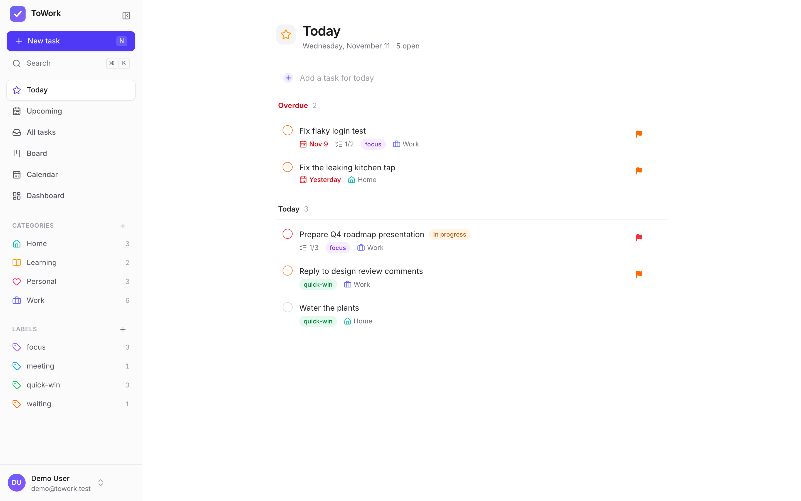
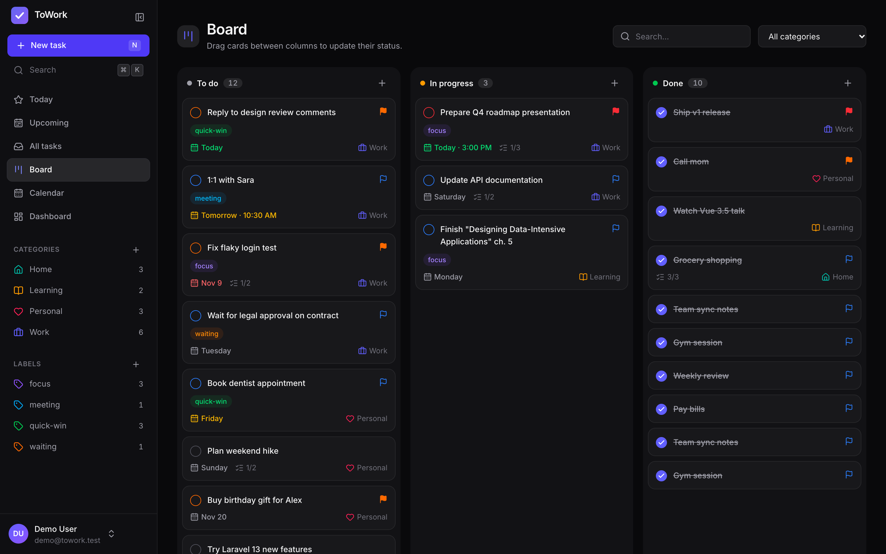
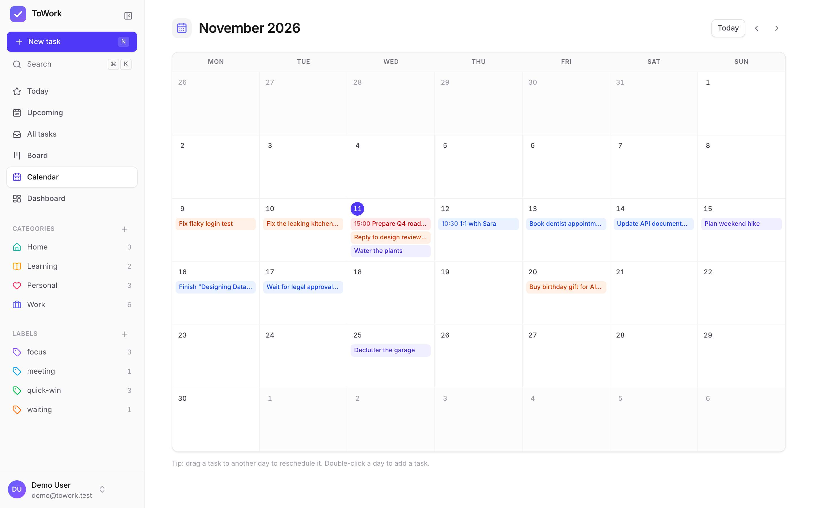
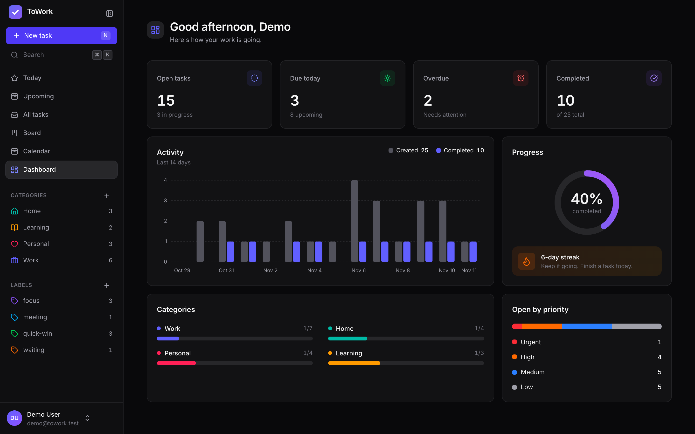

<p align="center">
  
</p>

<h1 align="center">ToWork (Vue frontend)</h1>

<p align="center">
  A calm, fast and open-source task manager: lists, Kanban board, calendar and dashboard.<br />
  This is the frontend for <a href="https://github.com/milwad-dev/towork-backend">towork-backend</a> (Laravel).
</p>

---

## Screenshots

Light and dark themes, shown with the seeded demo account.

| Today (light) | Board (dark) |
|---|---|
|  |  |
| **Calendar (light)** | **Dashboard (dark)** |
|  |  |

## Features

- **Smart lists:** Today (with Overdue), Upcoming grouped by day, All tasks, and views per category and per label.
- **Quick add with natural syntax:** type `Call Sam tomorrow !high #Work @phone` and press Enter.
- **Task details drawer:** status, priority, due date and time, reminder, category, labels, description and subtasks, all autosaved.
- **Kanban board:** drag and drop between *To do*, *In progress* and *Done*, with optimistic updates.
- **Calendar:** month grid; drag a task to another day to reschedule it, double-click a day to add one.
- **Dashboard:** open, due-today, overdue and completed counts, a 14-day activity chart, completion rate, streak, and category and priority breakdowns.
- **Search, filters and sorting** by status, priority, due date, category and label.
- **Command palette** (`⌘K` / `Ctrl K`) and keyboard shortcuts (`N` new task, `/` search, `G` then `T/U/A/B/C/D` to navigate, `?` for help).
- **Accounts:** sign up, sign in with email or phone, email verification and password reset with 6-digit codes, profile and password settings, and account deletion.
- **Light and dark mode** (follows the system by default), a responsive layout with a mobile bottom bar, and accessible focus states and ARIA labels.

## Tech stack

[Vue 3.5](https://vuejs.org) · [Vite 8](https://vite.dev) · [Vue Router 5](https://router.vuejs.org) · [Pinia 4](https://pinia.vuejs.org) ·
[Tailwind CSS 4](https://tailwindcss.com) · [Lucide](https://lucide.dev) icons · [date-fns](https://date-fns.org) ·
[vue-draggable-plus](https://vue-draggable-plus.pages.dev) · [Vitest](https://vitest.dev)

## Getting started

### Requirements

- Node.js 20.19+ (LTS recommended)
- A running [towork-backend](https://github.com/milwad-dev/towork-backend) API (default `http://localhost:8000`)

### Development

```sh
git clone https://github.com/milwad-dev/towork-vue.git
cd towork-vue
cp .env.example .env      # point VITE_API_URL at your API
npm install
npm run dev               # http://localhost:5173
```

| Variable | Default | Description |
|---|---|---|
| `VITE_API_URL` | `http://localhost:8000/api/v1` | Base URL of the ToWork API, including the version prefix |

The backend must allow your frontend origin in CORS (and the `X-Timezone` header, which the app sends so "today" matches your local day).

### Scripts

| Command | Description |
|---|---|
| `npm run dev` | Start the dev server with hot reload |
| `npm run build` | Build for production into `dist/` |
| `npm run preview` | Preview the production build |
| `npm run test:unit` | Run unit tests with Vitest |
| `npm run lint` | Lint and auto-fix with ESLint |
| `npm run format` | Format the source with Prettier |

## Docker

The image is a two-stage build: Node builds the app, then a small `nginx:alpine` serves it with SPA routing, gzip, long-lived caching for hashed assets, and a `/healthz` endpoint.

```sh
docker compose up -d --build        # http://localhost:3000
```

The API URL is compiled into the bundle, so set it at build time:

```sh
VITE_API_URL=https://api.example.com/api/v1 APP_PORT=8080 docker compose up -d --build
```

Or with plain Docker:

```sh
docker build --build-arg VITE_API_URL=https://api.example.com/api/v1 -t towork-vue .
docker run -d -p 3000:80 towork-vue
```

## Project structure

```
src/
├─ assets/        # Tailwind entry and design tokens
├─ components/
│  ├─ app/        # Shell: sidebar, command palette, dialogs
│  ├─ tasks/      # Task row, quick add, drawer, pickers, filters
│  └─ ui/         # Generic UI: modal, popover, toasts, inputs
├─ composables/   # Shortcuts, confirm dialog, task actions
├─ layouts/       # App and auth layouts
├─ lib/           # API client, dates, constants, quick-add parser
├─ router/
├─ stores/        # Pinia: auth, tasks, categories, labels, ui
└─ views/         # Pages
```

## Contributing

Issues and pull requests are welcome. Please run `npm run lint` and `npm run test:unit -- --run` before opening a PR.

## License

ToWork is open-source software licensed under the [MIT license](https://github.com/milwad-dev/towork-backend/blob/main/LICENSE).
